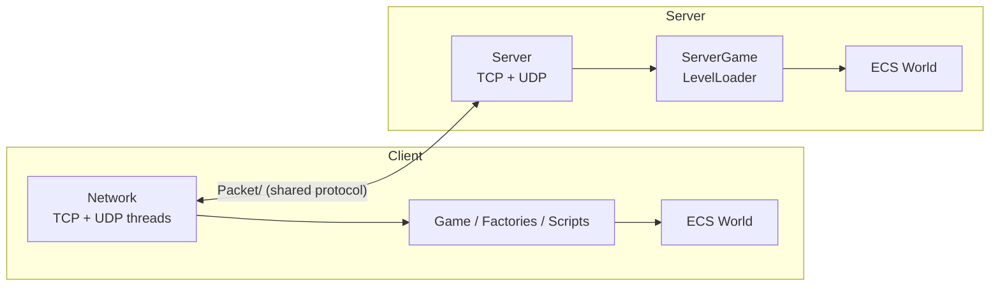

# R-Type

A networked multiplayer shoot 'em up in C++20, built on a custom Entity Component System, with an authoritative server and up to 4 players.

[À COMPLÉTER : capture — screenshot or GIF of a 2-player game with enemies on screen]

## Features

- **Client / server multiplayer**: up to 4 players per game (`MAX_PLAYER` in `Server/Game/ServerGame.hpp`)
- **Dual-protocol networking** over SFML Network: TCP for the lobby and game state changes, UDP for real-time updates, plus an ACK mechanism so that critical UDP packets (e.g. entity deaths) are not lost ([docs](docs/Server/ACK.md))
- **Custom ECS engine** (`ECS/`): 22 components (position, velocity, sprite, animator, box collider, HP, damage, script…) and 12 systems (movement, collision, animation, draw, audio, GUI, scripts…)
- **6 levels described in JSON** (`Levels/`), with several enemy types: basic, fast, shooting, sine-wave, tank, a boss, and heal pickups
- Game flow: waiting room, next level, game over / victory screens, retry, high score, credits
- **8 interface languages** (English, French, German, Spanish, Italian, Portuguese, Russian, Lingala) loaded from `assets/localization/`
- **Colour-blind mode** through a fragment shader (`assets/shaders/colorblind.frag`)
- UI widgets with TGUI; music and sound effects

## Tech stack

C++20 · SFML 3 (graphics, audio, network) · TGUI · CMake + CPM (dependencies are fetched at configure time) · Doxygen

## Build & run

Requirements: Linux, CMake ≥ 3.20, a C++20 compiler (tested with GCC), Git, and the SFML system dependencies (X11, OpenGL, OpenAL, FreeType…). SFML 3 and TGUI are downloaded by CPM during the first configure.

```bash
git clone https://github.com/MartinB-E/R-Type.git
cd R-Type
./build.sh          # configures and builds into build/

cd build            # assets are loaded from ../assets, so run from build/
./r-type_server -p 4444 -u 1111          # -p TCP port, -u UDP port, -d debug mode
./r-type_client -p 4444 -u 127.0.0.1     # in another terminal: -p server TCP port, -u server address
```

A `build.bat` script is provided for Windows (not re-tested for this README).

## Architecture



- `ECS/` — the engine: `World`, entities, components and systems, shared by client and server
- `Packet/` — packet serialisation and readers shared by both sides ([TCP](docs/TCP-protocol.md) and [UDP](docs/UDP-protocol.md) protocols)
- `Server/` — authoritative game logic, level loading from JSON, player management
- `Client/` — rendering, inputs, UI, localisation and per-entity scripts

More in [docs/architecture.md](docs/architecture.md) and [docs/ECS.md](docs/ECS.md).

## Context

Epitech 3rd-year project, November 2025 – January 2026, team of 5.
This repository is a copy of the team repository [MYAMBO/R-Type](https://github.com/MYAMBO/R-Type), kept with its full history.

**Team:** Martin Bonte, [Yanis Monté](https://github.com/YanisMonte), [Pierre Ryssen](https://github.com/Pierre1901), [Antoine Orange](https://github.com/Antoiix), [Timoté Koenig](https://github.com/timote1koenig)

**My contribution** (≈300 of the ~720 commits):
- Designed and wrote most of the **ECS engine** (`ECS/`), then reworked the draw system for performance
- Game screens and flow on the client: waiting room, game over / victory, credits, high score, next level and retry
- Server-side level change and game restart; fixes on player connection and threading
- Documentation of the ECS and game modules (`docs/`)

[À COMPLÉTER : confirmer / corriger ta contribution]
